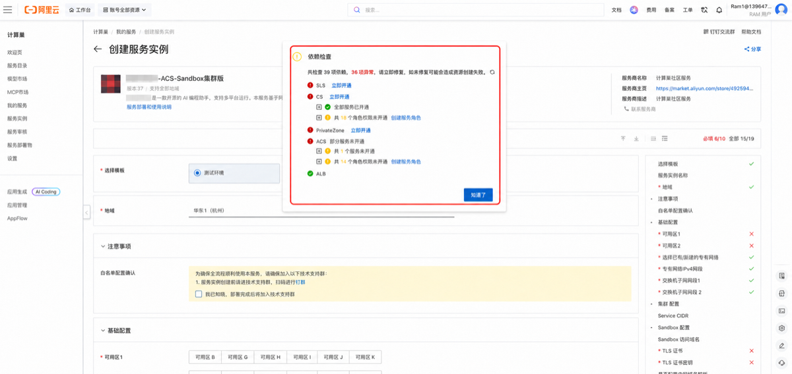
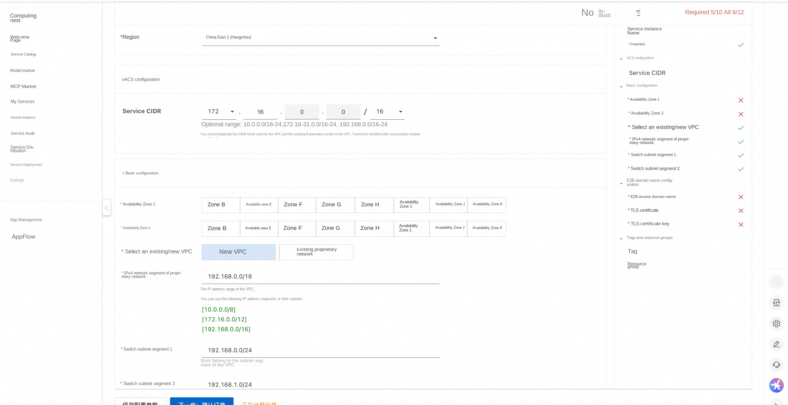
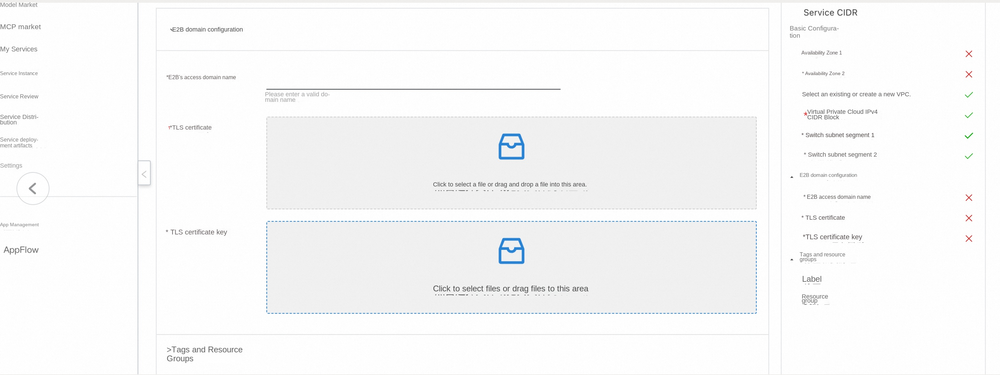
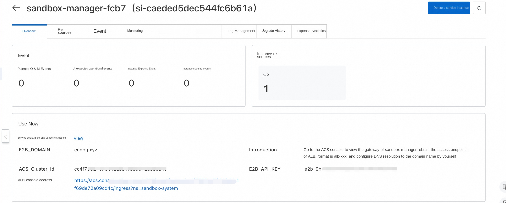

# Use E2B to manage Agent Sandbox

## Overview

E2B is a popular open source security sandbox framework that provides a simple and easy-to-use Python and JavaScript SDK for users to create, query, execute code, and request ports on security sandboxes. The ack-sandbox-manager component is a backend application compatible with the E2B protocol, enabling users to build a sandbox infrastructure with performance comparable to that of native E2B in any K8s cluster.

This service supports security sandbox deployment on ACS, a new ACK cluster, or an existing ACK cluster, with interaction through the E2B protocol.

## Prerequisites

The standard E2B protocol requires a domain name (E2B\_DOMAIN) to specify the backend service. To do this, you need to prepare your own domain name. The E2B client must request the backend through the HTTPS protocol, so it also needs to apply for a wildcard certificate for the service.

The following describes the steps for preparing domain names and certificates in the test scenario. The generated fullchain.pem and privkey.pem files will be used in the subsequent deployment phase.

### Prepare Domain Name

* In the test scenario, to facilitate verification, you can use the test domain name, for example: agent-vpc.infra.


### Obtain a self-signed certificate

For the certificate preparation steps, see the [official Agent Sandbox guide](https://www.alibabacloud.com/help/en/cs/user-guide/create-an-agent-sandbox). The [generate-certificates.sh](https://github.com/openkruise/agents/blob/master/hack/generate-certificates.sh) script generates the server certificate (`fullchain.pem`), its private key (`privkey.pem`), and the CA certificate (`ca-fullchain.pem`). Upload the server certificate and its private key during deployment. Other clients must trust the CA certificate when using a self-signed certificate.

### Activate Service
If you have not used the relevant cloud service before, you will be prompted to activate the service and create the corresponding service role during deployment, as shown in the following figure,

The permissions required in this step are relatively risky (the administrator permissions of the cloud product are required). We recommend that you use the following two methods to activate:
Note: opening is a one-time operation, and only needs to be opened during the first operation.
1. Contact a user with administrator rights to open the computing nest service deployment link, and let the administrator user open it according to the prompt.
2. Contact a user with administrator permissions to temporarily grant administrator permissions to the RAM user. After the RAM user is authorized, it can be activated. The required permissions are as follows.
Policy:[open_policy.json](open_policy.json)


### Authorize RAM users

If you are using a RAM user, you must authorize the RAM user to complete the deployment process. For more information, see [Authorization Document](https://help.aliyun.com/zh/compute-nest/security-and-compliance/grant-user-permissions-to-a-ram-user).

To deploy this service, ask an administrator to grant the following policies to the RAM user.

**System permission policies:**

- `AliyunComputeNestUserFullAccess`: Manage ComputeNest user permissions.
- `AliyunROSFullAccess`: Manage Resource Orchestration Service (ROS) permissions.

**Custom permission policy:**

- [policy.json](policy.json)

## Choose a deployment mode

Choose one of the following deployment modes:

| Deployment mode | Purpose |
| --- | --- |
| ACS Deployment | Create an ACS cluster. |
| ACK Deployment | Create a new ACK cluster. |
| Existing ACK Deployment | Deploy Sandbox components to an existing ACK cluster. |

Before using an existing ACK cluster, confirm that:

- `alb-ingress-controller` is either absent or installed and usable. If absent, the template installs it and creates a default AlbConfig; otherwise, it preserves the existing configuration.
- `ack-virtual-node` is either absent or at least v2.17.0. If absent, the template installs it; upgrade older installed versions manually first.
- The target VPC has two vSwitches in different zones for ALB.
- For an existing ACK deployment, follow the service outputs to configure DNS and Ingress HTTPS, and obtain the ALB endpoint from the cluster console.


## Deployment process

1. Open the ComputeNest deployment link for the [China site](https://computenest.console.aliyun.com/service/instance/create/cn-hangzhou?type=user&ServiceId=service-47d7c54c78604e0bbe79) or [international site](https://computenest.console.alibabacloud.com/service/instance/create/ap-southeast-1?type=user&ServiceId=service-7c3a2fa4dd3e46519c59).
2. Choose a deployment mode and region. For a new cluster, configure the Service CIDR and VPC. For an existing ACK cluster, select the cluster and configure the network settings required by ALB.

    

3. Enter the E2B domain prepared earlier. Upload `fullchain.pem` as the TLS certificate and `privkey.pem` as the TLS private key.

    

4. Configure the `E2B_API_KEY` used to access the E2B API.
5. Set the CPU and memory for Sandbox Manager as needed. The defaults are 2 vCPUs and 4 GiB.
6. Confirm the order to start deployment.
7. After deployment succeeds, obtain `E2B_API_KEY` and `E2B_DOMAIN` from the service instance details page.



## Sandbox configuration and SDK usage

For SandboxSet configuration, image requirements, E2B SDK integration, and pause/resume examples, see the [official Agent Sandbox guide](https://www.alibabacloud.com/help/en/cs/user-guide/create-an-agent-sandbox). This guide links to the official examples instead of maintaining duplicate sample code.

The ComputeNest fix release sets the warm pool replica count of the `code-interpreter` SandboxSet in the `default` namespace to 1.

## Verify the deployment

Open the ACS or ACK cluster from the service instance resource list. Sandbox Manager runs in `sandbox-system`; the test Pod runs in `default`.

### Use the test Pod in the cluster

1. Open the Pods page in the cluster console and select the `default` namespace.
2. Find `acs-sandbox-test-pod` (the full name of the test Pod). Wait for dependency installation to finish, then open its terminal.
3. Run the following commands in the terminal:

```bash
cd /app
python test_code.py
```

The script verifies sandbox creation, code and command execution, and file operations. Wait for all checks to pass. Deployment modes that include the corresponding samples also support `python test_browser.py` and `python test_desktop.py`.

For an existing ACK cluster, complete the DNS and Ingress HTTPS configuration described in the service outputs before running the tests.

### Connect from another client

Follow the [official Agent Sandbox guide](https://www.alibabacloud.com/help/en/cs/user-guide/create-an-agent-sandbox) to configure DNS, HTTPS, and the E2B SDK. Use `E2B_DOMAIN` and `E2B_API_KEY` from the service instance outputs.

For a private ALB, the client must have network access to the target VPC. When using a self-signed certificate, configure the client to trust the CA certificate `ca-fullchain.pem`.
