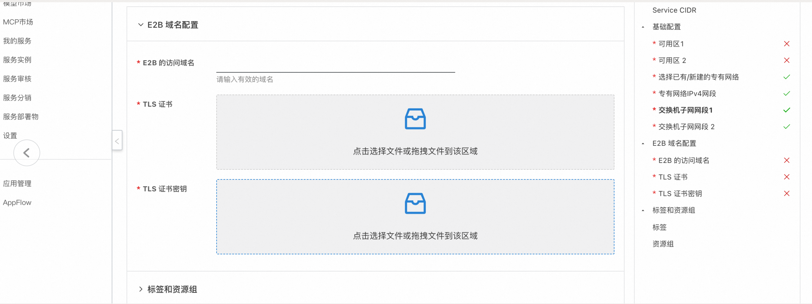

# 使用 E2B 管理 Agent Sandbox

## 概述

E2B 是一个流行的开源安全沙箱框架，提供了一套简单易用的 Python 与 JavaScript SDK 供用户对安全沙箱进行创建、查询、执行代码、请求端口等操作。 ack-sandbox-manager组件是一个兼容 E2B 协议的后端应用，使用户在任何 K8s 集群中一键搭建一个性能媲美原生 E2B 的沙箱基础设施。

本服务支持在 ACS、新建 ACK 或已有 ACK 集群中快速搭建安全沙箱，并使用 E2B 协议进行交互。

## 前置准备

标准的 E2B 协议需要一个域名（E2B\_DOMAIN）来指定后端服务。为此，您需要准备一个自己的域名。 E2B 客户端必须通过 HTTPS 协议请求后端，因此还需要为服务申请一个通配符证书。

以下介绍了测试场景下的域名和证书准备步骤，生成的fullchain.pem和privkey.pem文件在后续部署环节会用到。

### 准备域名

*   测试场景中，为了方便验证，可以使用测试域名，比如示例：agent-vpc.infra。
    

### 获取自签名证书

通过脚本[generate-certificate.sh](https://github.com/openkruise/agents/blob/master/hack/generate-certificates.sh) 创建自签名证书, 您可以通过以下命令查看脚本的使用方法。

```plaintext
$ bash generate-certificates.sh --help

Usage: generate-certificates.sh [OPTIONS]

Options:
  -d, --domain DOMAIN     Specify certificate domain (default: your.domain.com)
  -o, --output DIR        Specify output directory (default: .)
  -D, --days DAYS         Specify certificate validity days (default: 365)
  -h, --help              Show this help message

Examples:
  generate-certificates.sh -d myapp.your.domain.com
  generate-certificates.sh --domain api.your.domain.com --days 730
```

生成证书的命令示例：

```plaintext
./generate-certificates.sh --domain agent-vpc.infra --days 730
```

完成证书生成后，您会得到以下文件：

*   fullchain.pem：服务器证书公钥
    
*   privkey.pem：服务器证书私钥
    
*   ca-fullchain.pem：CA 证书公钥
    
*   ca-privkey.pem：CA 证书私钥 该脚本会同时生成单域名（your.domain）与泛域名（\*.your.domain）证书，兼容原生 E2B 协议与 OpenKruise 定制 E2B 协议。
    
### 开通服务
如果您之前没有使用过相关云服务，在部署时会提示您先开通服务和创建相应服务角色，如下图所示，

此步骤需要的权限相对风险较高(需要云产品的管理员权限)，推荐您选用以下两种方式进行开通：
注意：开通为一次性操作，仅第一次操作时需要开通。
1. 联系有管理员权限的用户打开计算巢服务部署链接，让管理员用户按照提示进行开通。
2. 联系有管理员权限的用户对RAM用户暂时授予管理员权限，RAM用户得到授权后进行开通，需要的权限策略如下。
开通服务权限策略：[open_policy.json](open_policy.json)


### 给RAM 用户授权

如果您使用的是RAM用户，需要授权RAM用户相关权限，才能够完成部署流程，参考[授权文档](https://help.aliyun.com/zh/compute-nest/security-and-compliance/grant-user-permissions-to-a-ram-user)
 
部署此服务需要的权限策略包括两个系统权限策略和一个自定义权限策略, 请联系有管理员权限的用户对RAM用户授予以下权限：

**系统权限策略：**

- `AliyunComputeNestUserFullAccess`：管理计算巢服务（ComputeNest）的用户侧权限。
- `AliyunROSFullAccess`：管理资源编排服务（ROS）的权限。

**自定义权限策略：**

- [policy.json](policy.json)


## 选择部署方式

可选择以下三种部署方式：

| 部署方式 | 用途 |
| --- | --- |
| ACS 部署 | 创建 ACS 集群。 |
| ACK 部署 | 创建新的 ACK 集群。 |
| 已有 ACK 部署 | 在现有 ACK 集群中部署 Sandbox 组件。 |

使用已有 ACK 集群前，请确认：

- `alb-ingress-controller` 未安装或已安装且可用。未安装时模板会自动安装并创建默认 AlbConfig；已安装时保留现有配置。
- `ack-virtual-node` 未安装或版本不低于 v2.17.0。未安装时模板会自动安装；低版本需要先手动升级。
- 目标 VPC 中有两个位于不同可用区的交换机，供 ALB 使用。
- 已有 ACK 部署完成后，按照服务输出配置 DNS 和 Ingress HTTPS；在集群控制台查看 ALB 访问端点。


## 部署流程

1.  打开计算巢服务部署链接：[国内站](https://computenest.console.aliyun.com/service/instance/create/cn-hangzhou?type=user&ServiceId=service-47d7c54c78604e0bbe79)或[国际站](https://computenest.console.alibabacloud.com/service/instance/create/ap-southeast-1?type=user&ServiceId=service-7c3a2fa4dd3e46519c59)
    
2.  选择部署方式和部署地域。新建集群时填写 Service CIDR 和专有网络配置；已有 ACK 模式选择现有集群及 ALB 所需的网络配置。
    
    
    
3.  填写E2B 域名配置，E2B的访问域名配置为上述前提准备阶段的域名，
    
    1.  TLS 证书选择fullchain.pem文件
        
    2.  TLS 证书私钥选择privkey.pem文件 
        
    
    
4.  会生成访问E2B API的 E2B\_API\_KEY
    
5.  sandbox-manager 组件默认的CPU和内存配置默认为2C, 4Gi, 可以按需调整
    
6.  配置完成后，点击确认订单
    
7.  部署成功后，在服务实例的详情页也可以查看E2B\_API\_KEY、E2B\_DOMAIN等信息 
    


## Agent Sandbox 沙箱定义与 SDK 使用

SandboxSet 配置、镜像要求、E2B SDK 接入及休眠唤醒示例，请参考[官网 Agent Sandbox 文档](https://help.aliyun.com/zh/cs/user-guide/create-an-agent-sandbox)。此处不重复维护示例代码。

计算巢修复版本将 `default` 命名空间中的 `code-interpreter` SandboxSet 预热副本数设为 1。

## 服务部署验证

部署完成后，在服务实例的资源列表中打开对应的 ACS 或 ACK 集群。Sandbox Manager 位于 `sandbox-system`，测试 Pod 位于 `default`。

### 使用集群内测试 Pod

1. 在集群控制台的容器组页面，选择 `default` 命名空间。
2. 找到 `acs-sandbox-test-pod`（测试 Pod 的完整名称），等待容器完成依赖安装后打开终端。
3. 在终端执行以下命令：

```bash
cd /app
python test_code.py
```

该脚本验证沙箱创建、代码与命令执行、文件读写。等待所有检查通过。包含对应样例的部署方式还可执行 `python test_browser.py` 和 `python test_desktop.py`。

已有 ACK 模式需先完成服务输出中的 DNS 和 Ingress HTTPS 配置，再执行测试。

### 在其他客户端接入

请按[官网 Agent Sandbox 文档](https://help.aliyun.com/zh/cs/user-guide/create-an-agent-sandbox)配置域名解析、HTTPS 入口和 E2B SDK，使用服务实例输出的 `E2B_DOMAIN` 与 `E2B_API_KEY`。

内网 ALB 需要从能访问目标 VPC 的网络接入。使用自签名证书时，调用端需要信任对应的 CA 证书公钥 `ca-fullchain.pem`。
